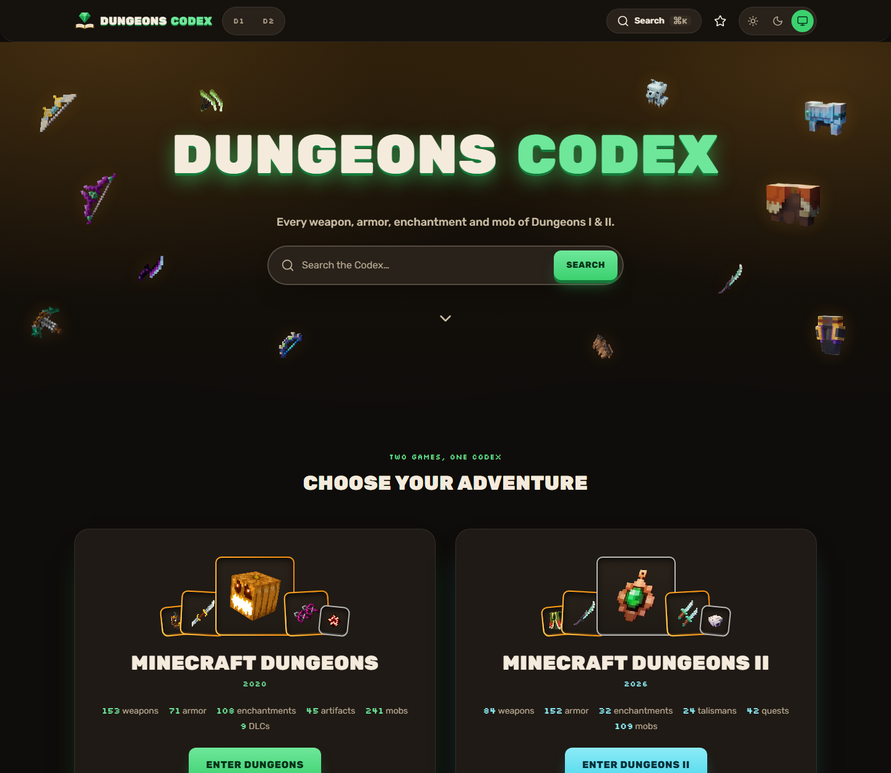

# Dungeons Codex

A fast, friendly fan wiki for **Minecraft Dungeons** (2020) and **Minecraft Dungeons II** (2026): every weapon, armor, enchantment, artifact, talisman, quest, mob and location, with powerful filters, instant search and a few tools the wiki does not have.



> **Unofficial.** Dungeons Codex is a fan site. It is not an official Minecraft product and is not approved by or associated with Mojang or Microsoft. Game data and images come from the [Minecraft Wiki](https://minecraft.wiki) under CC BY-NC-SA 3.0.

## Features

- **16 sections, 1,467 entries.** Eight per game (Dungeons: weapons, armor, enchantments, artifacts, DLCs, cosmetics, mobs, locations. Dungeons II: weapons, armor, enchantments, artifacts, talismans, quests, mobs, locations), each with a full detail page and two-way cross-links between items, mobs, locations and enchantments.
- **Type first, then filter.** Pick a type (Melee, Ranged, Dual-wield, ...), then narrow by damage, speed, rarity, location, properties and more. Every filter state lives in the URL, so any view can be shared.
- **Codex Search.** `Ctrl/⌘ + K` opens a fuzzy search across both games with typo tolerance and aliases.
- **Power Forge.** A stat simulator on weapon and armor pages: move the power slider, add enchantments, watch damage change. Documented wiki values are exact; everything computed is marked **Approximate**.
- **Compare and Favorites.** Compare up to four items of one category side by side; star favorites. Both are saved in your browser, with export and import.
- **Build Planner.** A shareable loadout for either game, stored entirely in the link.
- **Dark and light themes**, a distinct accent color per game, responsive from 360 px up, WCAG 2.2 AA, keyboard friendly.
- **No accounts, no ads, no trackers, no cookies.** Fully static; nothing leaves your browser.

## Tech stack

Next.js (App Router, static generation) · React 19 · TypeScript (strict) · Tailwind CSS v4 · Radix UI · Zod · nuqs · FlexSearch + cmdk · sharp · Vitest + Testing Library · Playwright + axe-core. Hosted on Vercel.

Data is scraped from minecraft.wiki **on a developer machine** (`npm run data:sync`), validated, and committed as JSON. The deployed site reads only those files; it never contacts the wiki.

## Local setup

Requires **Node.js 22 LTS** and npm.

```bash
npm ci
```

```bash
npm run dev
```

Open <http://localhost:3000>. To run the end-to-end tests once, install the browser: `npx playwright install chromium`.

## Scripts

| Script                  | What it does                                                                                                 |
| ----------------------- | ------------------------------------------------------------------------------------------------------------ |
| `npm run dev`           | Next.js dev server                                                                                           |
| `npm run build`         | Production build (runs `data:index` first; never contacts the wiki)                                          |
| `npm run start`         | Serve the production build                                                                                   |
| `npm run typecheck`     | `tsc --noEmit`                                                                                               |
| `npm run lint`          | ESLint                                                                                                       |
| `npm run format`        | Prettier, write                                                                                              |
| `npm run format:check`  | Prettier, check only                                                                                         |
| `npm run check:hex`     | Fails on any raw hex colour in `src/` (colors come from design tokens)                                       |
| `npm run test`          | Vitest unit and component tests                                                                              |
| `npm run e2e`           | Playwright specs against the production build on port 3100 (desktop and 390 px phone, axe on every template) |
| `npm run verify`        | typecheck, lint, format check, hex check, unit tests, data validation, build: **run before every commit**    |
| `npm run data:sync`     | Scrape minecraft.wiki into `data/` and `public/images/` (see below)                                          |
| `npm run data:validate` | Zod-validate every generated file and check cross-references                                                 |
| `npm run data:coverage` | Print the coverage report; exits 1 if a category is below 98 %                                               |
| `npm run data:index`    | Build the search index, compare, Forge and planner data (the `prebuild` hook)                                |
| `npm run knip`          | Find unused files and exports                                                                                |

## Refreshing the data

```bash
npm run data:sync -- --game all --category all --images --refresh
```

```bash
npm run data:validate && npm run data:coverage && npm run data:index
```

```bash
npm run verify
```

```bash
git add data public/images && git commit -m "data: refresh from minecraft.wiki"
```

The sync takes at most one request per second, identifies itself without personal details, and caches every response in `data/raw-cache/` (gitignored). `--offline` replays the cache with zero requests. Full details, troubleshooting and how to add a category or filter: [docs/MAINTAINING.md](docs/MAINTAINING.md).

### Adding an override

When the wiki is wrong or missing a value, never edit `data/generated/`. Add a correction with a source to `data/overrides/{game}/{category}.json`; the next sync applies it and records it on the entity:

```json
[
  {
    "slug": "claymore",
    "set": { "comboLength": 3 },
    "reason": "List table is missing the value",
    "sourceUrl": "https://minecraft.wiki/w/Dungeons:Claymore"
  }
]
```

## Project structure

```
dungeons-codex/
├─ src/
│  ├─ app/            routes: /, /{game}, /{game}/{category}, detail pages, compare, planner, favorites, about
│  ├─ components/     ui (design-system primitives), layout, entity, filters, features (forge, compare, planner, search)
│  ├─ config/         games, categories, display, filter definitions: declarative, per game and category
│  ├─ lib/            data loaders (server-only), schemas (Zod), filter engine, forge math, planner codec, storage
│  └─ styles/         tokens.css (the one source of colors, radii, shadows) + Tailwind
├─ scripts/           wiki client, parsers, pipeline, validate, index, dev audits
├─ data/              generated (committed), overrides, vocab, forge curves, reports, raw-cache (ignored)
├─ public/            images (self-hosted WebP), brand, generated search/compare/forge/planner JSON
├─ tests/             unit, fixtures (saved wiki responses), e2e
└─ docs/              MAINTAINING.md, quality audits, Lighthouse results
```

## Testing

- `npm run test`: unit and component tests (filter engine, Forge math, planner codec and stores at 100 % branch coverage; parsers against saved fixtures).
- `npm run e2e`: every page template on a desktop and a 390 px phone viewport in both themes, with axe (zero serious or critical violations), keyboard, SEO, legal-text, edge-state and security-header checks.
- `npm run verify` is the gate for every commit.

## Deployment

1. Push this repository to GitHub.
2. Import it on <https://vercel.com/new>, and set **Root Directory** to `dungeons-codex`. Keep the Next.js defaults.
3. After the first deploy, add the environment variable `NEXT_PUBLIC_SITE_URL` (your production URL, no trailing slash) and redeploy, so the sitemap, canonical links and share images use the right address.

There are no secrets. The build never contacts the wiki; its only network use is `next/font` downloading Rubik and Silkscreen from Google Fonts once (it then serves them from your own domain). Security headers and a Content Security Policy are set in `next.config.ts`.

## Licenses

- **Source code:** MIT, see [LICENSE](LICENSE).
- **Data and images** (`data/`, `public/images/`): [CC BY-NC-SA 3.0](https://creativecommons.org/licenses/by-nc-sa/3.0/), derived from the Minecraft Wiki. Non-commercial use only; share alike; see [data/LICENSE.md](data/LICENSE.md). The data has been reformatted, normalized and combined; computed values are marked Approximate.
- Item and mob artwork is © Mojang Studios / Microsoft and is shown for identification in a non-commercial fan context. Dungeons Codex has its own wordmark and uses no official Minecraft or Minecraft Dungeons logos.

## Credits

Game data and images: the volunteers of the [Minecraft Wiki](https://minecraft.wiki). Fonts: Rubik and Silkscreen (SIL Open Font License) through `next/font`. Icons: Lucide. Minecraft and Minecraft Dungeons are trademarks of Mojang Synergies AB.
